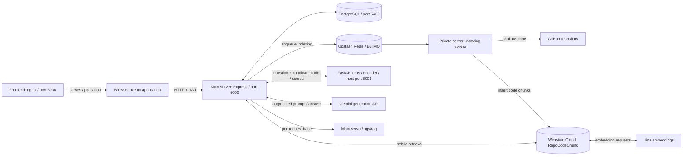

# Codebase-Chatbot: architecture and working flow

This document describes the current implementation. The application answers
questions about a GitHub repository by searching indexed code, reranking the
search results, and sending selected code to Gemini. This is retrieval augmented
generation (RAG): the model receives repository evidence at question time.

## Services and responsibilities



| Component | Code location | Responsibility |
| --- | --- | --- |
| Frontend | `Frontend/src/` | Login, repository selection, chat UI, pending state and history polling |
| Web server / API | `Main server/` | JWT validation, database operations, queue submission, full question-answer pipeline and request logs |
| Indexing worker | `Private server/src/` | Clone, parse, split and store repository code; consumes BullMQ jobs |
| Reranker | `Reranker/app.py` | Score question/code pairs with a local cross-encoder |
| PostgreSQL | Compose `postgres` service | Users, repository records, chats, questions, answers and processing status |
| Weaviate Cloud | Backend and worker clients | Code text, metadata, embeddings and hybrid search |
| Upstash Redis | BullMQ connection configuration | Stores indexing jobs and their lifecycle |
| Jina | Configured through Weaviate | Embeddings used for vector search |
| Gemini | `Main server/util/ragOutput.js` | Generates an answer using the final repository context |

The indexing worker has no HTTP port. Redis and Weaviate are external services,
not additional containers in this Compose file. The reranker runs locally;
Gemini is a separate external service.

## 1. Authentication and repository registration

1. Registration hashes the password with bcrypt (10 rounds) and creates an `AUTH`
   record. Login verifies it and signs a JWT with a seven-day expiry.
2. The frontend stores the token in local storage and attaches it as
   `Authorization: Bearer ...` to API requests.
3. Adding a repository calls `POST /api/repo/save-repo` with its URL and email.
4. The API creates `REPO_INPUT`, then adds a `repo-index` job to the
   `repo-index-queue` BullMQ queue with `{ email, repo_url, repo_id }`.
5. The API returns the repository record. This confirms registration/queue
   submission; it does not mean indexing has finished. Worker logs show completion.

## 2. Repository indexing

The worker in `Private server/src/index.js` runs with concurrency 5.
`handler/indexer.js` performs these steps for each job:

1. Ensure the `RepoCodeChunk` collection exists. If it already exists, add missing
   metadata properties without deleting the stored vectors. New collections use
   the Jina `jina-embeddings-v2-base-code` vectorizer on the `text` property.
2. Create a temporary directory and run `git clone --depth 1` using argument-based
   process execution. This indexes a snapshot of the repository's default branch.
3. Find supported files while excluding directories such as `.git`, `node_modules`,
   `dist`, `build`, `venv`, `.next`, and `target`. Supported patterns include common
   source languages, Markdown, HTML, Terraform, YAML, shell scripts, CSS, TOML,
   Dockerfile variants, Jenkinsfile, and Makefile. See `EXTENSION_MAP` for the exact list.
4. `treesitter.js` extracts functions/classes and other language-specific units.
   If a grammar is unavailable, parsing fails, or no units are found, the whole
   file becomes one unit. Units are split into approximately 800-character chunks
   with 150-character overlap, retaining file paths and one-based line numbers.
5. Each chunk gets deterministic `chunk_id` and `unit_id` metadata, its signature,
   chunk index, token count, repository ID, repository URL, and user email.
   Token counting uses `cl100k_base` when available, otherwise a characters/4 estimate.
6. Insert chunks in batches of 50. Weaviate requests embeddings using the configured
   Jina key. Parser failures that escape the fallback and batch-insert errors fail
   the job rather than silently reporting success.
7. Remove the temporary clone in `finally`, whether indexing succeeds or fails.

An internal `onlyMissingFiles` job flag preserves already indexed file paths and
indexes missing ones. It is a repair mechanism, not change detection for updated
files. Normal indexing does not automatically track subsequent GitHub commits.

## 3. A user asks a question

```mermaid
sequenceDiagram
    participant UI as React chat
    participant API as Main server
    participant DB as PostgreSQL
    participant W as Weaviate
    participant R as Reranker
    participant G as Gemini
    UI->>UI: Add question and Processing bubble immediately
    UI->>API: POST /api/prompt/save-prompt
    API->>DB: Check repository owner; create chat if needed; save prompt
    API-->>UI: HTTP 201: prompt_id, chat_id, processing
    API->>W: Retrieve candidates filtered by repo_id
    W-->>API: Code text, locations, hybrid scores
    API->>R: Question and candidate texts
    R-->>API: Score for each candidate
    API->>API: Check confidence, expand, dedupe, pack context
    API->>API: Write exact final prompt to request trace
    API->>G: Generate answer from prompt
    G-->>API: Answer or provider error
    API->>DB: Save response, status, sources and error code
    loop Every 2 seconds while chat is open
        UI->>API: GET /api/prompt/get-prompts/:chat_id
        API-->>UI: Persisted messages and processing stages
    end
    UI->>UI: Display answer or request failure
```

`chat_id: -1` means create a chat for the selected repository. For an existing
chat, the API derives the repository ID from that chat and verifies that its
owner matches the authenticated user's email before accepting the question.

`promptController.js` sends HTTP 201 before starting generation through
`process.nextTick`. The generation work runs in the **web server process**;
BullMQ is used for repository indexing, not for chat generation.

`Frontend/src/hooks/useChatMessages.js` keeps optimistic messages visible while
the POST and history requests are pending. It ignores stale history responses
and cancels polling when the selected chat changes. Axios requests have a
15-second timeout; the initial POST does not wait for Gemini to finish.

Processing stages are `queued`, `retrieval`, `reranking`, `context`, `generation`,
and optionally `retrying`. Success stores status `done` and stage `complete`;
failure stores status `failed`, the failed stage, and an error code. The frontend
also has a local `sending` stage before the API acknowledges the request.

## 4. RAG pipeline in the web server

The entry point is `Main server/util/ragOutput.js`. Defaults live in
`Main server/config/rag.config.js`.

| Stage | Implementation | Current behavior |
| --- | --- | --- |
| Retrieve | `pipeline/retrieve.js` | Weaviate hybrid search combines BM25 keyword and dense vector search, filters by integer `repo_id`, and returns up to 30 chunks. Alpha is 0.5 with relative-score fusion. |
| Rerank | `pipeline/rerank.js` | POST question and candidate texts to `http://reranker:8000/rerank`. Attach one score per candidate and sort descending. Timeout is 30 seconds. |
| Confidence | `pipeline/confidenceFloor.js` | Compare the highest score with 0.1. Low confidence adds guidance to the model; it does not itself delete chunks. |
| Expand | `pipeline/expand.js` | When confidence permits, select up to 5 parent units using relative threshold 0.6. Units up to 900 tokens include all chunks; larger units include the first/signature chunk and retrieved chunks with neighbors. Inherited scores use a 0.8 multiplier. |
| Dedupe | `pipeline/dedupe.js` | Keep the first occurrence of each `chunk_id`. |
| Pack | `pipeline/pack.js` | Select units using the relative threshold, retaining at least 2 units where available. Prefer directly retrieved chunks, pack within an 8000-token context budget, then sort by file path and line for readability. |
| Augment | `util/augmenter.js` | Combine the question, code blocks with file/line locations, confidence guidance, and instructions to answer only from context. |
| Generate | `util/generateWithRetry.js` | Call the configured Gemini model, validate nonempty text, and retry eligible transient provider errors. |
| Persist | `controllers/promptController.js` | Store answer, source locations, confidence, processing status and error code in PostgreSQL. |

The 8000-token budget is for code context, not an exact Gemini input or output
token limit. Prompt instructions and the question add further text. Source
metadata lists selected context locations; it is not proof that every listed
chunk was cited by the model.

The final prompt currently includes the current question and repository
snippets. Earlier chat messages are displayed and stored, but are not injected
into the next model prompt as conversational memory.

### Reranker scores

The default model is `cross-encoder/ms-marco-MiniLM-L-6-v2`. FastAPI loads it
lazily and caches it in memory. Each question/text pair is limited to the model's
512-token maximum length. Scores are raw model scores; they can be negative and
are not percentages. Larger values rank higher for the same query.

The backend validates that the response contains exactly one finite score per
candidate. On a timeout, HTTP error, or invalid scores, it continues with hybrid
scores. Trace entries label these alternatives explicitly:

| `score_source` | Meaning |
| --- | --- |
| `cross_encoder` | Actual reranker model output |
| `hybrid_fallback` | Reranker failed, so the retrieval score was reused |
| `hybrid_rerank_disabled` | Reranking was disabled through pipeline configuration |

`reranked_chunks` is the authoritative record of the original model scores.
Expansion may replace scores with unit-level or inherited values; use
`selected_context` to inspect what actually entered the prompt. The current
unit aggregation starts at zero, so negative scores are effectively floored at
zero during unit selection. The trace preserves the original negative scores.
Thresholds are heuristics and should be calibrated using representative code questions.

### Model errors and retries

`GEMINI_MODEL` selects the model; the current default is `gemini-3.5-flash-lite`.
The backend makes at most 3 attempts with a 30-second timeout per call. Eligible
HTTP statuses are 429, 500, 502, 503, and 504, with exponential delays starting
at 1 and 2 seconds. Provider retry hints can extend those waits. Daily quota
failures and retry hints longer than 10 seconds are returned without further
attempts. Invalid credentials and empty responses are not retried.

The application retries the same configured model; it does not automatically
switch models. `GEMINI_UNAVAILABLE` indicates provider HTTP 503, while
`GEMINI_QUOTA_EXCEEDED` indicates HTTP 429. A healthy reranker does not imply
that Gemini has available capacity or quota.

## Request logs

Every accepted question reaching `generation()` automatically creates a separate
JSON Lines file, with one JSON object per event:

```text
Host:      Main server/logs/rag/prompt-<prompt_id>-<request_uuid>.jsonl
Container: /app/logs/rag/prompt-<prompt_id>-<request_uuid>.jsonl
```

The existing `./Main server:/app` bind mount makes these files visible in the
IDE and preserves them across backend container recreation. A direct pipeline
call without a database prompt ID uses `request-<uuid>.jsonl`. Every event has
`request_id`, `prompt_id`, `chat_id`, `repo_id`, UTC `timestamp`, `elapsed_ms`,
`event`, and `data` fields. Different requests never share a file.

| Event | Recorded data |
| --- | --- |
| `request_started` | Original question |
| `pipeline_config` | Retrieval, reranking, confidence, expansion and packing settings |
| `retrieved_chunks` | Full code and locations in retrieval order, with hybrid scores |
| `reranked_chunks` | Full code in ranked order, hybrid scores, reranker scores and score sources |
| `selected_context` | Actual packed chunks in prompt order, counts through intermediate stages, token estimates and confidence |
| `final_prompt` | Exact untruncated string sent as Gemini `contents`, model name and character count |
| `generation_retry` | Next attempt number and HTTP status |
| `completed` | Model answer, sources and confidence; database persistence follows this event |
| `failed` | Pipeline stage, public error message, error code and provider HTTP status if available |

Events are written as stages finish, so the final prompt remains available if
Gemini fails. A failure before prompt construction naturally has no `final_prompt`
event. Restarting the process mid-request can leave an incomplete trace. Login,
history polling, and rejected requests do not run RAG and do not create these files.

The terminal shows compact `[rag-trace]` messages with the request ID, prompt ID,
file path and event. On completion or failure it also prints a plain-language
`[rag-summary]` block: retrieved/reranked/unique/selected chunk counts, duplicate
removal, estimated context tokens, confidence, model, retries, timing and result.
The same text is saved beside the JSONL as `prompt-<id>-<uuid>.summary.txt`.
Fallback search scores are explicitly distinguished from actual reranker scores;
stages not reached on failed requests are labeled accordingly. These summaries
describe generation completion, before the answer is persisted to PostgreSQL.
Full content stays in the JSONL file. File-write failures report
`write_failed` without stopping answer generation. API keys, JWTs and user emails
are not added as trace metadata; questions, source code and answers are recorded
verbatim. Trace files are excluded from Git and Docker builds, and are not served
through an HTTP endpoint. They are retained until manually removed; no automatic
rotation is implemented.

Run the following from the directory containing `docker-compose.yml`:

```powershell
# Watch request stages and the path to each trace
docker compose logs -f --tail 50 backend

# Load the newest trace into PowerShell objects
$traceFile = Get-ChildItem 'Main server/logs/rag/*.jsonl' |
    Sort-Object LastWriteTime -Descending | Select-Object -First 1
$events = Get-Content -LiteralPath $traceFile.FullName | ForEach-Object { $_ | ConvertFrom-Json }

# Display the exact multiline model prompt
($events | Where-Object event -eq 'final_prompt').data.prompt

# Compare candidate scores and file locations
($events | Where-Object event -eq 'reranked_chunks').data.chunks |
    Format-Table rank, file_path, start_line, end_line, hybrid_score, rerank_score, score_source -AutoSize

# Print retrieved code, locations and scores in full
($events | Where-Object event -eq 'retrieved_chunks').data.chunks | Format-List *

# Find a particular request using the prompt ID shown in application logs
Get-ChildItem 'Main server/logs/rag/prompt-19-*.jsonl'
```

Reranker HTTP logs are separate: `docker compose logs -f reranker`. They show
endpoint status; the detailed question/chunk/score trace belongs to the web server.

## Data model and storage

| Store | Data |
| --- | --- |
| PostgreSQL `AUTH` | User ID, unique email, name and password hash |
| PostgreSQL `REPO_INPUT` | Repository ID, owner email, URL and creation time |
| PostgreSQL `CHAT` | Chat ID, optional title and repository foreign key |
| PostgreSQL `PROMPT` | Question, answer, chat foreign key, status, stage, error code, JSONB sources, confidence and timestamps |
| Weaviate `RepoCodeChunk` | Chunk/unit IDs, code, file/line metadata, signature, chunk index, token count, repository/user metadata and embedding |
| Redis | BullMQ indexing jobs, states and failure information |
| Local trace files | Per-question pipeline evidence and exact model input/output |

`CHAT.repo_id` and `PROMPT.chat_id` have cascading database foreign keys.
`REPO_INPUT.email` is an application-level owner field, not a declared database
foreign key to `AUTH`. SQL repository deletion currently does not remove the
corresponding Weaviate vectors. Deterministic chunk metadata alone does not make
repeated `insertMany` indexing an upsert.

## Main API routes

| Method | Path | Purpose |
| --- | --- | --- |
| POST | `/api/auth/register` | Register |
| POST | `/api/auth/login` | Get token |
| POST | `/api/repo/save-repo` | Save repository and enqueue indexing |
| GET | `/api/repo/get-repo/:repo_id` | Repository details |
| GET | `/api/repo/get-all-repos/:email` | Repository list |
| DELETE | `/api/repo/delete-repo/:repo_id` | Delete SQL repository record |
| GET | `/api/chat/get-chat/:chat_id` | Chat details |
| GET | `/api/chat/get-all-chats/:repo_id` | Chats for repository |
| POST | `/api/prompt/save-prompt` | Accept a question and start generation |
| GET | `/api/prompt/get-prompts/:chat_id` | History including status and source metadata |
| GET | `/api/prompt/get-prompt-status/:prompt_id` | Poll one prompt |

`routes/ragRoutes.js` is commented out; `/api/query/generate` is not mounted.
The active chat submission route is `/api/prompt/save-prompt`.

## Running and maintaining the application

Use the root `.env` with Docker Compose. `.env.example` lists required settings.
Compose supplies separate environments to the backend and indexing worker.

| Service | Host access | Internal Docker address |
| --- | --- | --- |
| Frontend | http://localhost:3000 | `frontend:80` |
| API | http://localhost:5000 | `backend:5000` |
| Reranker | http://localhost:8001/docs | `reranker:8000` |
| PostgreSQL | `localhost:5432` | `postgres:5432` |

```powershell
# Start/build the complete stack
docker compose up -d --build
docker compose ps

# Load a changed Gemini key or model from .env
docker compose up -d --no-deps --force-recreate backend

# Reload backend source changes (source is bind-mounted)
docker compose restart backend

# Frontend is compiled into nginx; source edits require a rebuild
docker compose up -d --build frontend

# Inspect indexing, API, and reranker events
docker compose logs --tail 100 private backend reranker

# Focused backend tests and parser tests, without live model calls
docker compose exec -T backend node --test tests/generation.test.js tests/ragTrace.test.js
docker compose exec -T backend node --experimental-test-module-mocks --test tests/ragTrace.integration.test.js
docker compose exec -T private node --test src/handler/treesitter.test.js

# Stop without deleting persistent data
docker compose stop
```

The browser regression tests run from `Frontend/` with `npm run test:browser`.
The real integration check is `docker compose exec backend node scripts/smoke-test.js`;
it uses external API quota and creates temporary records. Cloud-vector cleanup
requires Weaviate `delete_data` permission.

## Diagnosing a failed or missing answer

1. Check browser network activity for the initial POST and subsequent history GETs.
   A successful POST returns a prompt ID immediately; it is not the final answer.
2. Find `[prompt:<id>]` in backend logs and `prompt-<id>-*.jsonl` in the trace folder.
3. Inspect `retrieved_chunks`: zero or irrelevant results suggest missing indexing,
   repository filtering, embedding/search issues, or unsupported files.
4. Inspect `reranked_chunks`: `cross_encoder` confirms real model scores;
   `hybrid_fallback` means the pipeline continued after a reranker failure.
5. Inspect `selected_context` and `final_prompt` to see exactly what evidence the
   answer model received. Retrieval and final context can contain different chunks.
6. Check `generation_retry` and `failed` for Gemini errors. Changing the key/model
   requires recreating the backend to reload Compose's environment variables.
7. If generation completed but the UI has not updated, inspect SQL persistence
   logs and history polling. Trace `completed` is generation completion, not a
   database-commit acknowledgement.

Chat generation is currently in-process and is not resumed after backend restarts;
an interrupted prompt may stay `processing`. Reranker `/health` confirms the HTTP
service is alive, but does not force model loading or prove a real scoring request
will succeed. These are useful distinctions when interpreting logs.
